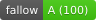
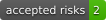
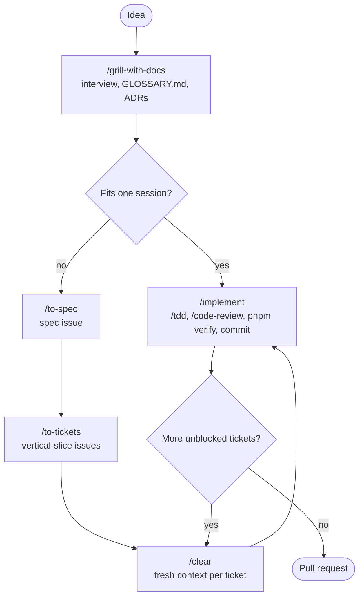

<p align="center">
  <a href="https://github.com/sponsors/niekes"></a>
</p>

<h1 align="center">Next.js AI Template</h1>

<p align="center">
  <strong>A Next.js starter built for AI coding agents.</strong><br>
  Architecture, conventions and security rules enforced by tools that fail the build.<br>
  Free and open source, kept alive by one maintainer and the people who sponsor the work.
</p>

<p align="center">
  <a href="https://github.com/Niekes/next-js-ai-template/actions/workflows/ci.yml"></a>
  
  
  
  <a href="LICENSE"></a>
  <a href="https://github.com/niekes/next-js-ai-template"></a>
  <a href="https://github.com/sponsors/niekes"></a>
</p>

<p align="center">
  <a href="https://nextjs.org/"></a>
  <a href="https://react.dev/"></a>
  <a href="https://www.typescriptlang.org/"></a>
  <a href="https://nodejs.org/"></a>
  <a href="https://pnpm.io/"></a>
  <a href="https://www.postgresql.org/"></a>
  <a href="https://tailwindcss.com/"></a>
  <a href="https://ui.shadcn.com/"></a>
  <a href="https://tanstack.com/query"></a>
  <a href="https://zod.dev/"></a>
  <a href="https://orm.drizzle.team/"></a>
  <a href="https://www.better-auth.com/"></a>
  <a href="https://vitest.dev/"></a>
  <a href="https://oxc.rs/"></a>
  <a href="https://fallow.tools/"></a>
</p>

<p align="center">
  <a href="#quick-start">Quick start</a> ·
  <a href="#what-keeps-the-code-in-shape">Guardrails</a> ·
  <a href="#recurring-maintenance">Maintenance</a> ·
  <a href="#for-ai-agents">For AI agents</a> ·
  <a href="#how-work-flows">How work flows</a> ·
  <a href="#deploy">Deploy</a> ·
  <a href="#sponsor-next-js-ai-template">Sponsor</a> ·
  <a href="#license">License</a>
</p>

A Next.js starter built for AI coding agents. Its architecture, conventions
and security rules are not just written down: they are enforced by tools that
fail the build, so an agent that skips the docs still cannot merge code that
breaks them ([ADR 0001](docs/adr/0001-deterministic-gates-advisory-ai-layer.md)).

**Stack**: Next.js 16 (App Router) · React 19 · TypeScript (strict) ·
Tailwind 4 + shadcn · TanStack Query · zod · Drizzle + Postgres · Better Auth
(email + password, admin role) · Vite+ (Oxlint, Oxfmt, Vitest) · Fallow.

> **Using this as your own project?** Click **Use this template**, then
> after `make setup`, run
> `/customize-template` in Claude Code. It renames the project, makes you the
> owner, removes the template's star and sponsor links and, if you want,
> deletes the notes example. Not using Claude Code? Follow the steps in
> [`.claude/skills/customize-template/SKILL.md`](.claude/skills/customize-template/SKILL.md#steps)
> by hand.

## Quick start

```bash
make setup    # install, create .env with a secret, start Postgres, migrate
make start    # Postgres + dev server; Ctrl+C stops the server
make stop     # stop Postgres (data is kept)
make          # list every target (test, lint, verify, db-studio, db-reset …)
```

Without `make` (e.g. on Windows):

```bash
pnpm install
docker compose up -d --wait          # Postgres on :54322
cp .env.example .env                 # then set BETTER_AUTH_SECRET (openssl rand -base64 32)
pnpm db:migrate
pnpm dev
```

Open <http://localhost:3000>, create an account, and add a note. To make
yourself admin, set your `role` to `admin` in `pnpm db:studio`.

## What keeps the code in shape

| Guardrail          | Tool                                                        | Fails when                                                                 |
| ------------------ | ----------------------------------------------------------- | -------------------------------------------------------------------------- |
| Architecture zones | Fallow boundaries + ArchUnit diagram test                   | an import crosses a forbidden edge (`docs/architecture.puml`)              |
| Types              | `tsc` strict + `noUncheckedIndexedAccess` and friends       | any type error                                                             |
| Lint               | Oxlint, type-aware, every rule an error, no warnings        | unsafe `any`, floating promises, a11y, raw browser APIs, enums …           |
| Coverage           | Vitest, 100 % on every metric                               | any uncovered line or branch                                               |
| Dead code & clones | Fallow                                                      | an unused export, file or dependency, any duplicated block                 |
| Health             | Fallow health score, ratchet only goes up                   | complexity or CRAP above threshold, score below the floor                  |
| Security           | `fallow security` + `security-accepted.json`                | a new risky sink without a human-approved reason                           |
| Auth on API routes | `route-auth.test.ts`                                        | a handler without `withAdmin*` or an opening `getUser()` check             |
| Gate integrity     | `coverage-gate`, `security-wiring`, `lint-directives` tests | a threshold, ignore list or hook is weakened, or a disable comment appears |
| Agent permissions  | `.claude/settings.json` + `scripts/agent-guard.ts` hook     | an agent's edit tool or shell command touches a protected or gate file     |
| CI & supply chain  | SHA-pinned actions, zizmor, `pnpm audit`, pnpm trust policy | an unpinned action, a workflow flaw, a high advisory, a trust downgrade    |
| Gate ownership     | `.github/CODEOWNERS` (pinned by `security-wiring` test)     | a pull request changes a gate file without a human approval                |

All of it runs in one command, `pnpm verify`, which is also what CI runs
(CI adds the network-bound `pnpm audit` and zizmor).
Husky runs the fast part on commit and push.

## Recurring maintenance

Some checks are too broad or too slow for every commit. Dependabot runs on
its own; the rest are skills or scripts a human starts on a fixed rhythm.

| What                                                              | Triggered by | Rhythm                       |
| ----------------------------------------------------------------- | ------------ | ---------------------------- |
| Dependabot (npm, GitHub Actions, Docker, Compose)                 | automatic    | weekly, 7-day cooldown       |
| `/security-audit` — full security review                          | a human      | monthly and before a release |
| `/ponytail-audit` — bugs, load, untested risk, what to delete     | a human      | monthly                      |
| `/ponytail-debt` — ledger of every `shortcut:` comment            | a human      | monthly                      |
| `pnpm fallow:full` — dead code, clones and health across the repo | a human      | monthly                      |

To run the human-triggered ones unattended, schedule them as Claude Code
routines with `/schedule`.

## For AI agents

- [AGENTS.md](AGENTS.md) (also loaded as `CLAUDE.md`) — commands, layout, protected paths
- [docs/](docs/) — architecture, conventions, database, quality gates, workflow
- [GLOSSARY.md](GLOSSARY.md) and [docs/adr/](docs/adr/) — domain language and decisions
- `.agents/skills/` — vendored skills (grilling, spec, tickets, implement, domain modeling, TDD, review, Fallow, security audit, ponytail, Chrome's [Modern Web Guidance](https://developer.chrome.com/docs/modern-web-guidance/get-started)); the flow is in [docs/workflow.md](docs/workflow.md#flow)
- `pnpm gen component <name>` / `pnpm gen feature <name>` — scaffold convention-correct code with a test

## How work flows

Every change in this repo goes through the same skills, from idea to pull
request. Details are in [docs/workflow.md](docs/workflow.md#flow).



## Deploy

`Dockerfile` builds a standalone Next.js server. Set `POSTGRES_URL`,
`BETTER_AUTH_SECRET` and `BETTER_AUTH_URL`, and run `pnpm db:migrate` against
the production database before starting a new version.

Run it behind a reverse proxy that sets `X-Forwarded-For` (nginx:
`proxy_set_header X-Forwarded-For $proxy_add_x_forwarded_for;`), and keep port
3000 unreachable from outside. Sign-in is rate-limited per client IP, read from
that header: a client that reaches the server directly can forge it, and
without the header every user shares one limit. If more proxies sit in front of
that one (a CDN in front of nginx), set `TRUSTED_PROXIES` to their addresses,
comma-separated IPs or CIDR ranges such as the CDN's published ranges.

## Sponsor next-js-ai-template

**next-js-ai-template** is free, and it always will be. There is no company
behind it, just one maintainer working in spare time, so the cost of keeping it
alive is paid for by the people who depend on it.

If this template saves you time, [become a sponsor](https://github.com/sponsors/niekes).

| Tier        | What you get                                                                                |
| ----------- | ------------------------------------------------------------------------------------------- |
| **$5/mo**   | Your name in the [sponsors list](#sponsors) and my sincere thanks                           |
| **$25/mo**  | The above, plus your logo in the README and priority issue triage                           |
| **$100/mo** | The above, plus direct email access for feature requests and a mention in the release notes |

Where the money goes:

- **Issue triage and bug fixes.** Sponsorship buys a reply within a couple of days instead of whenever I get to it.
- **A stack that keeps up.** Keeping Next.js, React, Better Auth, Drizzle, Tailwind and the tooling current.
- **Gates that keep up.** New lint rules, Fallow checks and security gates as agents find new ways around them.
- **Time for new work.** More worked examples, skills and generators.

Prefer a one-off? The [sponsor page](https://github.com/sponsors/niekes) also takes one-time contributions.

**Need a company sponsorship or an invoice?** [Get in touch](mailto:s@niekes.com).

## Sponsors

Thank you to the people who make this possible. Sponsors at $25/mo and above
get their logo in this README; everyone gets their name below.

<!-- New sponsors go below this line, one per line. -->

## Star History

[](https://www.star-history.com/#niekes/next-js-ai-template&type=date&legend=bottom-right)

## License

[MIT](LICENSE)
