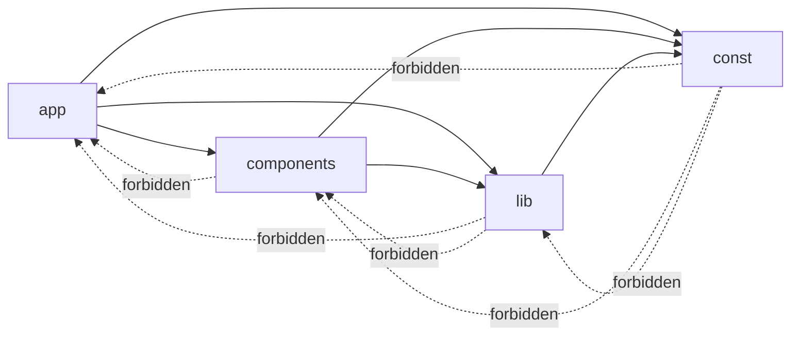

# Architecture

Three zones, declared explicitly in `.fallowrc.json` (no preset).

| Zone       | Files                                             | May import from |
| ---------- | ------------------------------------------------- | --------------- |
| **app**    | `src/app/**`                                      | shared          |
| **shared** | `src/components/**`, `src/lib/**`, `src/const/**` | nothing in app  |
| **root**   | `src/proxy.ts`                                    | shared          |

The shared zone is coarse, so a second, finer-grained assertion lives in the
executable diagram test at `src/lib/architecture/diagram.test.ts`, which splits
`shared` into `components`, `lib` and `const`. The diagram source of truth is
`docs/architecture.puml` (loaded via `adhereToDiagramInFile`); the mermaid below
is generated from it (`pumlToMermaid`, dashed edges are the forbidden complement),
and CI renders both the target and the actual dependency graph into the workflow
run summary (`pnpm arch:diagram`).

Key consequences:

- `app/` → `lib/`, `app/` → `components/` are allowed.
- `lib/` → `components/` is **not** allowed. Infrastructure must not depend on
  UI. Fallow cannot see this edge (both are in `shared`); the diagram test is
  the only gate for it.
- `const/` is a leaf: exports only, imports nothing from other zones.
- `src/proxy.ts` (route protection) is a root entry point that may import from
  `lib/` and `const/`. It sits directly under `src/`, so the diagram test does
  not cover it — Fallow's `root` zone does.

Check zones with `pnpm exec fallow list --boundaries`; check violations with
`pnpm exec fallow dead-code --boundary-violations`.

Fallow zones and the diagram test are two views of the same matrix, and
`docs/architecture.puml` is its single source of truth: edit the puml first,
then `src/lib/architecture/sync.test.ts` fails until `.fallowrc.json` and the
mermaid block above match it. Fallow is the cheap gate (`pnpm fallow:check`);
the diagram and sync tests run under `pnpm test`.

## Where new code goes

- Page → `src/app/` (scaffold with `pnpm gen feature <name>`; pages under
  `src/app/dashboard/` require a session, see `src/proxy.ts`)
- API route → `src/app/api/`; every handler starts with an auth check
  (`route-auth.test.ts`)
- Shared UI component → `src/components/app-*.tsx` (scaffold with
  `pnpm gen component <name>`), built on shadcn primitives in
  `src/components/ui/` (CLI-generated, never hand-edited). Only `app-*` files
  may import `src/components/ui/`, and nothing outside it may import
  `radix-ui`; lint enforces both
- Business logic and validation → `src/lib/<area>.ts` or `src/lib/<area>/`
- Database schema and queries → `src/lib/db/`
- Client data hooks → `src/lib/hooks/`
- Constant → `src/const/`

## The notes example

One feature that crosses every zone, as a pattern to copy and then delete:

| Layer          | File                               |
| -------------- | ---------------------------------- |
| Schema         | `src/lib/db/schema/notes.ts`       |
| Queries        | `src/lib/db/queries.ts`            |
| Input contract | `src/lib/notes.ts` (zod)           |
| API route      | `src/app/api/notes/route.ts`       |
| Client hook    | `src/lib/hooks/use-notes.ts`       |
| Page           | `src/app/dashboard/notes/page.tsx` |

`src/app/api/admin/users/route.ts` shows the admin-only variant (`withAdmin`).
