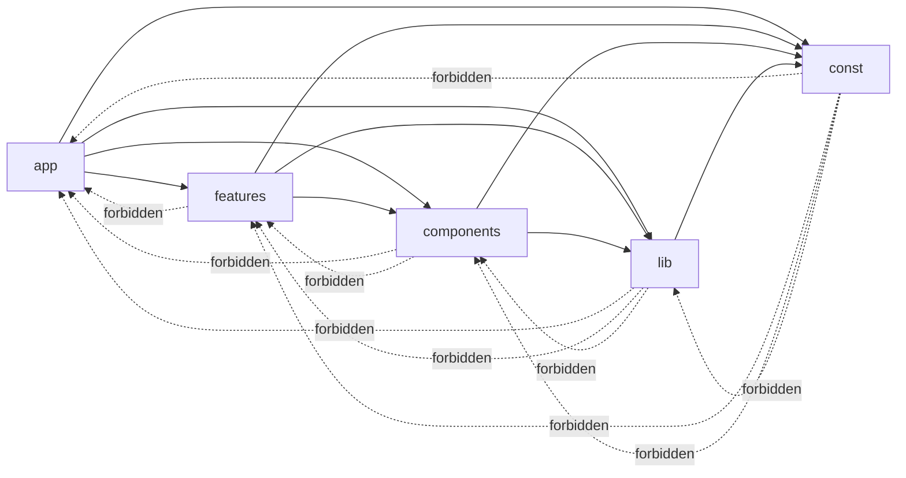

# Architecture

Bulletproof-react layering ([ADR 0003](adr/0003-bulletproof-feature-architecture.md)):
imports flow one way, **shared → features → app**. Four zones, declared
explicitly in `.fallowrc.json` (no preset).

| Zone         | Files                                             | May import from  |
| ------------ | ------------------------------------------------- | ---------------- |
| **app**      | `src/app/**`                                      | features, shared |
| **features** | `src/features/<name>/**`, one zone per feature    | shared           |
| **shared**   | `src/components/**`, `src/lib/**`, `src/const/**` | nothing          |
| **root**     | `src/proxy.ts`, `src/instrumentation.ts`          | shared           |

`autoDiscover` gives every folder under `src/features/` its own zone, so a
feature cannot import another feature. Code two features need moves to shared;
features are composed only in `app/`.

The shared zone is coarse, so a second, finer-grained assertion lives in the
executable diagram test at `src/lib/architecture/diagram.test.ts`, which splits
`shared` into `components`, `lib` and `const`. The diagram source of truth is
`docs/architecture.puml` (loaded via `adhereToDiagramInFile`); the mermaid below
is generated from it (`pumlToMermaid`, dashed edges are the forbidden complement),
and CI renders both the target and the actual dependency graph into the workflow
run summary (`pnpm arch:diagram`).

Key consequences:

- `features/` → `app/` and `features/a` → `features/b` are **not** allowed.
- `shared` imports nothing from `features/` or `app/`.

- `app/` → `lib/`, `app/` → `components/` are allowed.
- `lib/` → `components/` is **not** allowed. Infrastructure must not depend on
  UI. Fallow cannot see this edge (both are in `shared`); the diagram test is
  the only gate for it.
- `const/` is a leaf: exports only, imports nothing from other zones.
- `src/proxy.ts` (route protection) and `src/instrumentation.ts` (server error
  logging) are root entry points that may import from `lib/` and `const/`.
  They sit directly under `src/`, so the diagram test does not cover them —
  Fallow's `root` zone does.

Check zones with `pnpm exec fallow list --boundaries`; check violations with
`pnpm exec fallow dead-code --boundary-violations`.

Fallow zones and the diagram test are two views of the same matrix, and
`docs/architecture.puml` is its single source of truth: edit the puml first,
then `src/lib/architecture/sync.test.ts` fails until `.fallowrc.json` and the
mermaid block above match it. Fallow is the cheap gate (`pnpm fallow:check`);
the diagram and sync tests run under `pnpm test`.

## Where new code goes

- Feature → `src/features/<name>/` (scaffold with `pnpm gen feature <name>`).
  Only these folders, each optional: `api/` (input contract, client requests
  and query hooks), `components/`, `hooks/`, `server/` (database queries,
  imported only by server code: route handlers, Server Components and other
  `server/` files), `types/`,
  `utils/`. No `index.ts` barrels; import files directly. A feature's
  main component is `components/<name>-panel.tsx`, which its page frames.
  `src/lib/architecture/features.test.ts` enforces all three rules.
- Page → `src/app/`, thin: it frames feature components (pages under
  `src/app/dashboard/` require a session, see `src/proxy.ts`)
- API route → `src/app/api/`, thin: every handler starts with an auth check
  (`route-auth.test.ts`), then calls the feature's `server/`
- Shared UI component → `src/components/app-*.tsx` (scaffold with
  `pnpm gen component <name>`), built on shadcn primitives in
  `src/components/ui/` (CLI-generated, never hand-edited). Only `app-*` files
  may import `src/components/ui/`, and nothing outside it may import
  `radix-ui`; lint enforces both
- Code more than one feature needs → `src/lib/<area>.ts` or `src/lib/<area>/`
- Database schema → `src/lib/db/schema/` (drizzle-kit reads one schema for all
  features); shared queries such as `getUser` → `src/lib/db/queries.ts`
- Hooks that are not tied to a feature → `src/lib/hooks/`
- Constant → `src/const/`

## The notes example

One feature that crosses every zone, as a pattern to copy and then delete:

| Layer          | File                                            |
| -------------- | ----------------------------------------------- |
| Schema         | `src/lib/db/schema/notes.ts`                    |
| Queries        | `src/features/notes/server/notes.ts`            |
| Input contract | `src/features/notes/api/note-input.ts` (zod)    |
| Client hook    | `src/features/notes/api/use-notes.ts`           |
| Component      | `src/features/notes/components/notes-panel.tsx` |
| API route      | `src/app/api/notes/route.ts`                    |
| Page           | `src/app/dashboard/notes/page.tsx`              |

`src/app/api/admin/users/route.ts` shows the admin-only variant (`withAdmin`).
